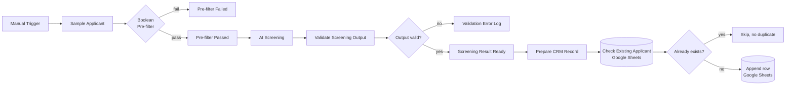

# AI Applicant Screening & Scoring


An n8n workflow that automates the first stage of hiring: it pre-filters applicants on hard requirements, scores the ones who pass, validates the scoring output, and records each candidate in a Google Sheets "CRM" without creating duplicates.


---

## Why I built it

Recruiters spend a large share of their time on first-pass screening, and that work is repetitive and inconsistent between reviewers. This project explores a pipeline that applies the same rules to every applicant, never lets a malformed AI response into the candidate database, and keeps a clean record with one row per applicant.

## Highlights

- **Two-stage screening:** a cheap rule-based pre-filter runs before the (more expensive) AI scoring step
- **Output validation guardrail:** AI results are schema-checked before anything is written; invalid results are routed to an error log instead of the database
- **Idempotent writes:** applicants are looked up before insert, so re-running the workflow never creates duplicate rows
- **Explicit failure branches:** every decision point has a defined path for both outcomes, with no silent drops

---

## How it works



| Stage | Node(s) | Purpose |
|---|---|---|
| Intake | Manual Trigger, Sample Applicant | Loads an applicant record (sample data for now) |
| Pre-filter | Boolean Pre-filter | Rejects applicants who miss hard requirements before any scoring |
| Scoring | Mock AI Screening (Code) | Produces a score and screening summary |
| Guardrail | Validate Screening Output, if(Output Valid?) | Checks the result's fields and types; invalid output goes to the error log |
| Record | Screening Result Ready, Prepare CRM Record | Shapes the final candidate record |
| De-duplication | Check Existing Applicant, Applicant Already Exists? | Looks up the applicant in the sheet first |
| Persist | Append row in sheet | Writes new applicants only |

<!-- TODO: add your actual pre-filter rules and scoring criteria, e.g.
## Screening criteria
| Check | Rule |
|---|---|
| Pre-filter | Minimum 2 years experience, work authorization = true |
| Score | 0–100 based on skills match, experience, ... |
-->

---

## Example output

<!-- TODO: replace with a real output item copied from the "Screening Result Ready" node -->

```json
{
  "applicant_name": "Jane Doe",
  "email": "jane@example.com",
  "role": "Automation Engineer",
  "prefilter_passed": true,
  "score": 82,
  "recommendation": "shortlist",
  "summary": "Strong workflow automation experience; matches 4 of 5 required skills.",
  "screened_at": "2026-10-26T07:00:00.000Z"
}
```

---

## Quick start

**Requirements:** n8n (self-hosted or Cloud) and a Google account.

1. Import [`workflow/ai-applicant-screening.json`](workflow/) via **Workflows → Import from File**.
2. Create a Google Sheet with a header row matching the CRM record fields.
3. Connect your Google Sheets credential in the two Sheets nodes and select your sheet.
4. Click **Execute workflow**. Run it a second time to confirm no duplicate row is added.

---

## Design decisions

- **Pre-filter before AI:** deterministic rules are free, fast and explainable, so the model only sees applicants worth scoring.
- **Treat AI output as untrusted input:** the validation step means a malformed or partial response can never corrupt the candidate database.
- **Check-then-append:** a lookup before insert keeps the sheet clean when the same applicant is processed twice.

## Current limitations

- The screening step is a **mock**: a Code node that simulates the AI response so the pipeline can be tested end to end without API costs.
- Input is a single sample applicant from a manual trigger.
- Google Sheets stands in for a real ATS/CRM.

## Roadmap

- [ ] Replace the mock with a real LLM node returning structured JSON
- [ ] Accept applications via webhook or form (e.g. Typeform, Google Forms)
- [ ] Parse CVs from PDF uploads
- [ ] Notify the hiring manager on Slack or email for shortlisted candidates
- [ ] Add a bias check by scoring with name and gender fields removed

---

## Related project

[FlowGuard AI](https://github.com/zm48713-cpu/flowguard-ai): automation failure diagnosis with n8n.

## Author

**Zain Ismail** · [GitHub](https://github.com/zm48713-cpu) · zm48713@gmail.com
